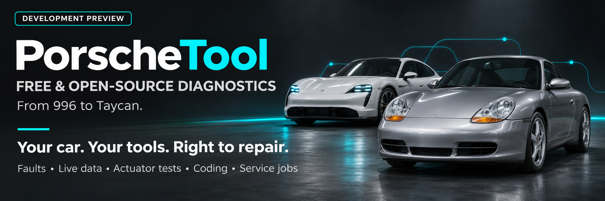

<p align="center">
  
</p>

<p align="center">
  <a href="https://github.com/brstic/porsche-tool/releases/latest"></a>
  <a href="https://github.com/brstic/porsche-tool/releases"></a>
  <a href="LICENSE"></a>
</p>

<p align="center">
  
  
  
  
  
  
</p>

<p align="center">
  <b>A free, open-source replacement for the dealer tester — for independent workshops and owners.</b><br>
  Every control unit of every Porsche from the 996 to the Taycan: faults with their freeze-frame data, live data,<br>
  actuator tests, routines, coding and one-click service jobs. One small exe and a cheap cable. Right to repair.
</p>

<p align="center">
  <a href="https://github.com/brstic/porsche-tool/releases/latest"><b>⬇ Download</b></a> ·
  <a href="docs/COVERAGE.md"><b>🚗 Vehicle coverage</b></a> ·
  <a href="ROADMAP.md"><b>🗺 Roadmap</b></a> ·
  <a href="docs/DEVELOPMENT.md"><b>🔬 How it works</b></a>
</p>

---

> [!IMPORTANT]
> **Status: not yet tested on a car.** Every layer is tested end to end against a simulated car — down to the CAN
> frames, through the real J2534 API and through a simulated serial adapter (see [Testing](#testing)). Addresses,
> functions and fault catalogues come from each vehicle line's diagnostic database. Please report what you see:
> every session is recorded to `PorscheTool_trace_*.ptrace`, and that file is the most useful thing to attach to an issue.

## Contents

- [What it does](#what-it-does)
- [Service jobs](#service-jobs)
- [PDK](#pdk)
- [Supported vehicles](#supported-vehicles)
- [Supported hardware](#supported-hardware)
- [Quick start (Windows)](#quick-start-windows)
- [Linux and macOS](#linux-and-macos)
- [Safety and scope](#safety-and-scope)
- [How it works](#how-it-works)
- [Building from source](#building-from-source)
- [Testing](#testing)
- [Contributing](#contributing)
- [Disclaimer](#disclaimer)

## What it does

| | | |
|---|---|---|
| 🚗 | **Knows the car** | Reads the VIN and loads the right vehicle data by itself — no menus to pick from. |
| 🔎 | **Scan all modules** | Every control unit: part number, software and hardware version, every stored fault in plain English with its status. |
| 🧊 | **Freeze-frame data** | Under each fault: how often it occurred, mileage, date and time, battery voltage and the snapshot values the unit stored. |
| 🧹 | **Clear all faults** | One click, with confirmation. |
| 🛠️ | **Service jobs** | The workshop procedures, one button each, from session to result — see [below](#service-jobs). |
| 📈 | **Live data** | Several values at once, with a live graph and a CSV log. |
| 🧪 | **Every function** | All actuator tests, routines, adaptation and coding values the unit's database defines (up to ~26 000 per car). |
| 🔐 | **Coding** | Coding writes unlock themselves with the unit's own seed/key algorithm — taken from the database, never guessed. |
| 📄 | **Reports** | Text and printable HTML report of every scan; the VIN can be hidden for sharing. |
| 🎞️ | **Record / replay** | Every session is recorded and can be replayed later without the car. |
| ⚠️ | **Safety notes** | A plain-language hazard note before anything that moves, bleeds, lifts or writes. |

## Service jobs

Each job finds the right control unit, opens the right session, unlocks it if needed, runs every step, follows the
routine until the unit reports the end, and tells you in plain words whether it worked — and if not, why.

| Job | | Job |
|---|---|---|
| Oil service reset / service interval reset | | PDK oil fill mode |
| Brake bleeding with the ABS pump | | PDK teach-in: shift rods · clutches · hydraulics |
| Parking brake: open / close for pad change, calibration | | PDK / Tiptronic adaptation reset |
| Air suspension ride-height calibration | | Engine adaptation reset |
| Level-sensor calibration | | Battery registration |
| Steering-angle sensor calibration | | PDCC fill and bleed |
| PSM sensor-cluster calibration | | Headlight range basic setting · axle-sensor calibration |
| Climate flap motor addressing | | A/C compressor run-in reset |
| Tyre pressure: take / write target pressures | | |

Which jobs each vehicle line has is listed in [docs/COVERAGE.md](docs/COVERAGE.md#guided-jobs-per-line).

## PDK

Everything the sister project [PdkTool](https://github.com/brstic/pdk-3000-tool) does for diagnosis — on every
line with a PDK (970, 991, 981/718, 997/987, 992, 918):

- fault memory with freeze-frame data, live data, identification;
- **oil fill mode** for filling and checking the transmission oil;
- **teach-in** of shift rods, clutches and hydraulics with live progress and travel-sensor values — and when a
  teach-in cannot run, the exact conditions that are not met (*selector lever in P*, *system pressure (engine
  running)*, …);
- adaptation reset and launch-control counter reset.

## Supported vehicles

| Line | Vehicle | Control units | Functions |
|---|---|--:|--:|
| G1 | Panamera (970) 2010-2016 | 44 | 10 706 |
| G2 | Panamera (971) 2017-2023 | 93 | 25 023 |
| 9x1 | 911 (991) · Boxster / Cayman (981, 718) 2012-2019 | 46 | 12 923 |
| 992 | 911 (992) 2019- | 68 | 22 746 |
| 918S | 918 Spyder 2013-2015 | 29 | 5 436 |
| CS1 | 911 / Cayman Clubsport race cars | 16 | 8 131 |
| Cajun | Macan (95B) 2014- | 46 | 15 380 |
| E2 | Cayenne (92A) 2011-2017 | 49 | 15 011 |
| E3 | Cayenne (9Y0) 2018- | 96 | 25 692 |
| J1 | Taycan (9J1) 2020- | 64 | 20 537 |
| 9x7 | 911 (997) · Boxster / Cayman (987) 2005-2012 | 37 | 3 372 |
| 9x6 | 911 (996) · Boxster (986) 1997-2005 | 24 | 726 |
| E1 | Cayenne (955 / 957) 2003-2010 | 46 | 1 395 |

Full per-line detail — live data, actuator tests, routines, coding values, fault codes, units with freeze-frame
data and coding keys, and the jobs of each line — in [docs/COVERAGE.md](docs/COVERAGE.md).

## Supported hardware

| Adapter | Where | Reaches |
|---|---|---|
| **J2534 PassThru** — Tactrix OpenPort 2.0 and others | Windows app | CAN (ISO-TP, 11/29-bit), K-line (ISO 14230), VW TP 2.0 |
| **SocketCAN** — candleLight, CANable, PEAK, Kvaser … | Linux CLI | CAN (kernel ISO-TP), VW TP 2.0 |
| **SLCAN serial CAN** — CANable, CANtact, USBtin … | macOS / Linux CLI | CAN (ISO-TP in user space), VW TP 2.0 |

The K-line units of the 996/986 and Cayenne 955/957 need a J2534 cable with K-line (e.g. Tactrix OpenPort 2.0).

## Quick start (Windows)

1. Install the driver of your J2534 adapter (Tactrix: *OpenPort 2.0 J2534 drivers*).
2. Download the [latest release](https://github.com/brstic/porsche-tool/releases/latest) and unpack it: `PorscheTool.exe` and the `data` folder go side by side.
3. Connect the adapter to the OBD port. Ignition **ON**, engine off. A battery charger is recommended.
4. Start `PorscheTool.exe`. The status line turns green and the car is recognised by itself.
5. Press **SCAN ALL MODULES** — or **SERVICE JOBS** for a procedure. Reports are saved next to the exe.

**No car at hand?** `PorscheTool.exe --demo` runs everything against a simulated Panamera.

<details>
<summary><b>Command line (Windows exe)</b></summary>

```text
PorscheTool.exe --scan                         scan, save the report, exit
PorscheTool.exe --clear-all                    clear every fault memory
PorscheTool.exe --vehicle auto --job pdk_oil_fill_mode
PorscheTool.exe --run PASM "Calibration height front left" 480
PorscheTool.exe --replay PorscheTool_trace_20261118.ptrace --scan
PorscheTool.exe --demo                         simulated car
```
</details>

## Linux and macOS

```sh
./build.sh                                                   # builds build/porschetool-cli
build/porschetool-cli --slcan /dev/cu.usbmodem1101 scan      # macOS / Linux: serial CAN adapter
sudo ip link set can0 up type can bitrate 500000
build/porschetool-cli --can can0 scan                        # Linux: SocketCAN
build/porschetool-cli --can can0 jobs                        # the service jobs of this car
build/porschetool-cli --can can0 job oil_service_reset
build/porschetool-cli --can can0 live PASM "height front left" 20
build/porschetool-cli --demo scan                            # simulated car, any OS
```

Run `porschetool-cli --help` for all commands (`vehicles`, `detect`, `modules`, `functions`, `faults`, `clear`,
`run`, `live`, `job`, `--record`, `--replay` …).

## Safety and scope

- **Confirmations** before anything that changes or moves something, with a plain-language note of the hazard
  (brake bleeding, suspension, steering, parking brake, high voltage …).
- **Coding keys are never guessed.** The algorithm comes from the control unit's own database entry; a key is only
  sent when the algorithm is known and the seed length fits, and a rejected key is never retried — a wrong key
  costs one of the unit's unlock attempts. Without a local key file everything except coding writes still works.
- **Not offered, on purpose:** odometer changes, immobiliser / key learning / component protection, airbag crash
  data, high-voltage safety disable, engine calibration and other emissions-relevant engine changes, flashing.
- **Online authentication (SFD)** on newer 992 / Taycan / 9Y0 / 971 units: coding writes there need the
  manufacturer's server and are not available offline — see [docs/SFD.md](docs/SFD.md). Reading, live data, tests,
  routines and jobs work offline.

## How it works

```
your PIWIS install ──tools/odxdb.py──▶ services, decoded responses, fault codes, addresses (per control unit)
                   └─tools/build_pack.py──▶ data/<LINE>.json  ◀── English texts, guided-job rules
src/engine.h      everything done with a car (portable C++17, tested without a car)
src/*_bus.h       J2534 · SocketCAN · SLCAN · simulator · record/replay, + ISO-TP and VW TP 2.0
src/porschetool.cpp   Windows app        src/cli.cpp   Linux / macOS command line
```

The released `data` packs are English and keyed by a hash of the original text, so they carry no original database
text. To rebuild them from your own installation (and to generate the local coding key file), see
[docs/DEVELOPMENT.md](docs/DEVELOPMENT.md).

## Building from source

```sh
./build.sh       # runs all tests, then builds PorscheTool.exe (32-bit, static, mingw-w64),
                 # the command-line tool and the mock adapter
```

32-bit on purpose: most J2534 drivers are 32-bit DLLs. Needs a C++17 compiler and, for the Windows app, mingw-w64.

## Testing

`./build.sh` runs, without a car:

- unit tests of fault parsing, status bytes and VIN handling;
- a sweep that builds the request and decodes a response for **every function of a pack**;
- the whole engine against a **simulated car**: scan with freeze-frame and snapshot data, HTML report, replay of the
  recorded session, VIN and part-number detection, routines followed to their end, coding write with security
  access, wrong-key handling, PDK teach-in (success and failure), guided jobs, live data, a door unit over VW TP 2.0;
- the **SLCAN** transport through a pseudo-terminal, frame by frame (ISO-TP and TP 2.0).

The mock adapter `build/op20pt32.dll` puts the same simulated car behind the J2534 API (CAN, K-line and raw CAN), so
`PorscheTool.exe` itself is tested end to end under Wine.

## Contributing

The most valuable contribution is a **session from a real car**: run a scan (and any job you need), then open an
issue with the `PorscheTool_trace_*.ptrace` file and the HTML report — hide the VIN with the checkbox if you prefer.
Wrong English texts can be fixed in `tools/i18n/`. See [ROADMAP.md](ROADMAP.md) for what is next.

## Disclaimer

Not affiliated with or endorsed by Porsche AG. "Porsche", "PIWIS" and model names are used only to describe
compatibility. Use at your own risk and follow the workshop manual for every procedure. MIT license.
